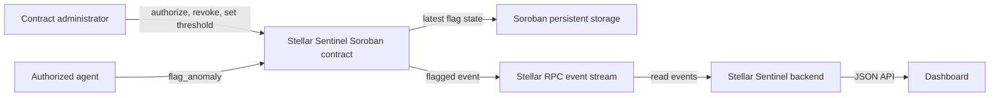

# Stellar Sentinel Soroban Contract

[](https://github.com/Stellar-Sentinel/sentinel-contracts/actions/workflows/ci.yml)
[](LICENSE)

Soroban contract for administrator-managed monitoring and response roles, a configurable 0–100 score threshold, and account flags. It publishes flag and administrative events and stores the latest flag for each subject. It does not store full history; event indexing is needed for that.

## Agent registry

`get_agents` returns the administrator-authenticated list of active agents. The registry has a configurable capacity up to 128 addresses; repeated authorization is idempotent, and revocation or grant expiry releases capacity. Legacy `authorize_agent` grants responder access. Explicit monitor and responder roles can be managed independently. Expiring grants are supported for up to 100,000 ledgers.

### Authorization invariants

All administrator helpers require authorization by the currently stored administrator before reading or changing agent state. `authorize_monitor` grants monitoring access only, while `authorize_responder` grants flag-submission access only; `authorize_agent` remains the legacy responder-compatible entry point. An address may hold both roles, and revoking one role preserves the other. An agent cannot submit flags unless it has the responder role, and an expired grant is treated as inactive at its expiry ledger.

Rejected authorization and flag-submission calls fail before any registry, latest-flag, or event write. Successful authorization changes publish `agent_add` with `(administrator, agent)` topics and `true`; `revoke_agent` publishes the matching `agent_del` event with `false`. Existing `authorize_monitor`, `authorize_responder`, and revoke helpers preserve the existing ABI and storage keys, so deployed instances remain compatible.

## Architecture



The backend reads events and does not sign or submit transactions. The contract and backend RPC must use the same network for events to appear in the dashboard.

### Configuration events

Initialization and administrative changes publish typed Soroban events for off-chain audit consumers:

| Topic 0 | Additional topics | Value | Meaning |
| --- | --- | --- | --- |
| `agent_add` | administrator address, affected agent address | `true` | The agent was authorized. |
| `agent_del` | administrator address, affected agent address | `false` | The agent was revoked. |
| `threshold` | administrator address | `(previous_threshold, new_threshold)` as two `u32` values | The risk threshold changed. |
| `init` | administrator address | `u32` threshold | The contract was initialized. |
| `pause` | administrator address | `bool` | New flag submissions were paused or resumed. |
| `gpause` / `gunpause` | guardian or administrator address | `bool` | Guardian pause state changed. |

The existing `flagged` event remains unchanged: its topics are `flagged`, agent address, and subject address, and its value is the `u32` score. The backend also decodes `flaggedv2` reports. Administrative event indexing is not currently shown in the dashboard. A failed or unauthorized call aborts before publishing an event.

`flag_anomaly_v3` adds a policy-aware event without changing existing entry points. Its topics are `flaggedv3`, agent address, subject address, and a bounded non-zero `policy_id` (1–1,000,000); its value is `(score, reason_mask)`, where `reason_mask` is a non-zero lower-16-bit mask. Invalid metadata, unauthorized callers, paused submissions, and below-threshold scores abort before state or events are written. Consumers should treat the versioned event as diagnostics, not proof of fraud.

## Testnet deployment

The current Stellar Sentinel instance is deployed and initialized on the **Stellar Testnet**. It uses the Testnet network passphrase `Test SDF Network ; September 2015` and the Soroban RPC endpoint `https://soroban-testnet.stellar.org`.

| Detail | Value |
| --- | --- |
| Contract ID | [`CBVFEUGUZ3P7A3F6B3SZKFJRTSANHYZDGEOFRCRLQL3FG6QCDO7MBJD7`](https://stellar.expert/explorer/testnet/contract/CBVFEUGUZ3P7A3F6B3SZKFJRTSANHYZDGEOFRCRLQL3FG6QCDO7MBJD7) |
| Contract source | [`78ac34d`](https://github.com/Stellar-Sentinel/sentinel-contracts/commit/78ac34d843b3838bcb7525cba7e63bd2f881c2bc) |
| Wasm SHA-256 | `f115f05839d51b1328cbdebca652161e7a5f4461ee70c5d93d390dd99b4a0a24` |
| Score threshold | `70` (initialized) |
| Admin account | `GBX5VED7NOWIUIRJODDMMWGCZKAICX2EDDMAABI6CKMK6YLVNJLIBHER` |
| Authorized monitoring agents | `GCPTFBMUINOWMG2DVVC5QV7FREUPUWEOLE5B3GUVVZ2SAJAARWWAGUBS` (responder role) |

Transaction records:

- Contract deployment (Wasm upload + instance creation): [transaction `d5d8faf5ff685f3e3443c54a10c80c46d721fa16f831b21385197df365a3370c`](https://stellar.expert/explorer/testnet/tx/d5d8faf5ff685f3e3443c54a10c80c46d721fa16f831b21385197df365a3370c), [transaction `6d0af48a56b489d00f5a2217bddca49aba38dbdf7040f5c55df4354ca0acc0ea`](https://stellar.expert/explorer/testnet/tx/6d0af48a56b489d00f5a2217bddca49aba38dbdf7040f5c55df4354ca0acc0ea)
- Initialization: [transaction `694702b39ce0727a9564bb38f5a5846d5ee2648dee6155c6438e7e5c2c6b8bdf`](https://stellar.expert/explorer/testnet/tx/694702b39ce0727a9564bb38f5a5846d5ee2648dee6155c6438e7e5c2c6b8bdf)
- Monitoring agent authorized as responder: [transaction `52a9113d0b562645d0512efdea79415dd5513ec5c6a757555113f51f812b4bd9`](https://stellar.expert/explorer/testnet/tx/52a9113d0b562645d0512efdea79415dd5513ec5c6a757555113f51f812b4bd9)

This redeploys the full current contract interface (agent registry/capacity, monitor/responder role separation, batch operations, pause/guardian controls, `flag_anomaly_v2`, admin handover, storage versioning) that the previous Testnet instance, deployed early in the project, predated and never received — Soroban contracts have no in-place upgrade path here, so superseding it required a fresh deployment. The admin identity alias `sentinel-admin-v2-testnet` is stored locally via Stellar CLI key storage; its secret is not in this repository. The backend's `.env.example` documents this contract ID (set a real value in a local, gitignored `.env`). The event feed is connected and now has an authorized agent (`sentinel-backend`'s optional monitoring agent, see its README) able to submit flags that cross the threshold.

### Reproduce a separate Testnet deployment

These commands create a **new** identity and contract instance; they do not redeploy or alter the contract above. Install the Stellar CLI, Rust, and the Wasm target first. Keep the generated identity in secure storage and never commit its seed phrase.

```bash
stellar keys generate sentinel-admin --network testnet --fund --secure-store
stellar contract build --locked
stellar contract deploy \
  --wasm target/wasm32v1-none/release/sentinel_contract.wasm \
  --source-account sentinel-admin \
  --network testnet \
  --alias sentinel_contract
stellar contract invoke \
  --id sentinel_contract \
  --source-account sentinel-admin \
  --network testnet -- \
  initialize --admin sentinel-admin --default-threshold 70
```

To verify this deployment's initialized threshold without submitting a transaction:

```bash
stellar contract invoke \
  --id <CONTRACT_ID> \
  --source-account sentinel-admin \
  --network testnet --send=no -- \
  get_threshold
```

Set the resulting contract ID as the backend's `CONTRACT_ID`. Keep its Horizon and Soroban RPC endpoints on Testnet as well.

### Migration, rollback, and emergency response

For an existing deployment, call `migrate_storage_version --admin <ADMIN>` once with the current administrator. It only backfills the schema marker when absent and rejects unsupported versions; it does not rewrite agent roles, flags, or events. If an instance predates the agent registry, call `migrate_agent_capacity --admin <ADMIN> --active-count <COUNT> --capacity <CAPACITY>` with verified values before using capacity-sensitive helpers. Verify `get_storage_version`, `get_agent_count`, `get_agents`, and the role views after migration.

Authorization changes are ordinary Soroban transactions and are not reversible by a contract upgrade. To roll back a mistaken grant, revoke the affected role (or call `revoke_agent`) and confirm the registry and role views; previously published events remain immutable. Keep the prior deployment and its contract ID available until consumers have been verified against the replacement.

For an incident, the administrator can call `pause` or `set_paused --paused true`; a configured guardian can call `guardian_pause` without resume authority. Confirm `is_paused` and `is_guardian_paused`, then resume with `unpause` or `resume_from_guardian_pause` only after the incident is contained. These controls block all flag-submission entry points but leave read-only configuration and latest-flag views available.

## Project layout

- `src/lib.rs` — contract entry points, storage keys, authorization, threshold checks, event publication, and latest-flag lookup.
- `src/test.rs` — contract behavior tests using Soroban test utilities.
- `Cargo.toml` / `Cargo.lock` — Rust and Soroban SDK dependencies.
- `.github/workflows/ci.yml` — Wasm build, unit tests, and Clippy checks.

## Build and test

Requires stable Rust, the `wasm32-unknown-unknown` and `wasm32v1-none` targets, and Stellar CLI for optimized deployment builds. There are no contract-specific environment variables; network IDs and signing identities are supplied to deployment tooling outside this repository.

```bash
rustup target add wasm32-unknown-unknown wasm32v1-none
cargo build --target wasm32-unknown-unknown --release
stellar contract build --locked
cargo test
cargo clippy --all-targets -- -D warnings
```

See [`docs/EVENT_SCHEMA.md`](docs/EVENT_SCHEMA.md) for the stable topic/value
contract, [`docs/WASM_BUDGET.md`](docs/WASM_BUDGET.md) for release budgets, and
[`docs/DEPLOYMENT_VERIFICATION.md`](docs/DEPLOYMENT_VERIFICATION.md) for
read-only Testnet verification.
For storage retention, archival restore, migration, and rollback procedures,
see [`docs/TTL_ARCHIVAL_OPERATIONS.md`](docs/TTL_ARCHIVAL_OPERATIONS.md).

The reviewed invariants, boundary cases, RPC examples, and versioning rules
are in [`docs/EVENT_TOPIC_SCHEMA_DESIGN.md`](docs/EVENT_TOPIC_SCHEMA_DESIGN.md).

The CI Wasm artifact is under `target/wasm32-unknown-unknown/release/`. `stellar contract build --locked` creates the optimized deployable artifact under `target/wasm32v1-none/release/`. CI runs the Wasm build, tests, and lint checks (Clippy).

## Contract interface

- `get_interface_version()` — return the interface generation; increment it for incompatible method or event changes.
- `get_contract_config()` — read the administrator and threshold together; returns `None` before initialization.
- `get_configuration_snapshot()` — read a bounded configuration snapshot without refreshing TTLs. It includes optional administrator/guardian values, active-agent count, capacity, pause state, and storage version; agent identities remain available only through the administrator-authenticated `get_agents` method.
- `get_configuration_view()` — read a bounded, non-sensitive snapshot of initialization, threshold, pause, guardian, capacity, active-agent count, and storage/interface versions. It is public, emits no event, preserves the existing ABI, and returns optional fields for legacy or uninitialized instances. See [`docs/read-only-configuration-views.md`](docs/read-only-configuration-views.md).
- `get_storage_version()` / `migrate_storage_version(admin)` — inspect and backfill the instance storage schema version.
- `initialize(admin, default_threshold)` — one-time admin and threshold setup.
- `is_initialized()` — check configuration state without causing an uninitialized-state panic.
- `get_admin()` — read the configured administrator after initialization.
- `transfer_admin(current_admin, new_admin)` — require both addresses to authorize an administrator handover.
- `authorize_agent(admin, agent)` / `revoke_agent(admin, agent)` — manage legacy responder grants. `authorize_monitor` / `authorize_responder` and matching revoke methods manage roles independently. Batch methods handle up to 16 addresses; `revoke_self(agent)` lets an agent remove its own grant.
- `authorize_agent_until(admin, agent, expires_at_ledger)` — grant responder access through a ledger-bounded expiry.
- `set_agent_capacity(admin, capacity)` / `get_agent_capacity()` / `get_agent_count()` / `get_agents(admin)` — manage and inspect the capped agent registry. `migrate_agent_capacity` supports existing instances.
- `set_threshold(admin, threshold)` / `get_threshold()` — configure/read the threshold. Repeating the current value refreshes instance TTL without rewriting state or emitting a duplicate audit event.
- `set_submission_quota(admin, window_ledgers, max_flags)` / `get_submission_quota()` — configure or inspect the bounded per-agent circuit-breaker quota. Existing deployments use the documented defaults when these keys are absent.
- `is_score_accepted(score)` — preflight the score range and active threshold; `flag_anomaly` remains authoritative.
- `pause(admin)` / `unpause(admin)` / `set_paused(admin, paused)` / `is_paused()` — stop or resume new flag submissions; read operations remain available.
- `set_emergency_guardian(admin, guardian)` / `guardian_pause(guardian)` / `resume_from_guardian_pause(admin)` — provide a guardian with pause-only emergency authority.
- `is_guardian_paused()` — inspect the emergency guardian latch without changing state.
- `is_agent(agent)` — check agent authorization and extend the active contract instance TTL.
- `flag_anomaly(agent, subject, score)` — require an authorized agent and a score at or above threshold; persist the latest record and publish `flagged`.
- `flag_anomaly_v2(agent, subject, score, report_digest)` — apply the same validation and record update, then publish a versioned event with a fixed 32-byte report digest.
- `flag_anomaly_v3(agent, subject, score, policy_id, reason_mask)` — apply the same validation and record update, then publish bounded policy and reason metadata in a versioned event.
- `flag_anomalies(agent, submissions)` — submit 1–16 subject/score entries in one transaction, validating the full batch before writes.
- `get_latest_flag(subject)` — read the latest record, if one exists.
- `clear_latest_flag(admin, subject)` — clear a subject's latest record; previously published events remain available for indexing.

Successful initialization and state-changing administrative calls publish the corresponding events described above. Agent-grant reads do not extend each grant's TTL; expired grants are removed from the active registry when agent counts or lists are refreshed. `get_latest_flag` refreshes a live persistent flag record when it is read, using the same bounded threshold and bump as flag writes.

Only trusted addresses should receive agent authorization. The contract enforces the score range and threshold, but it cannot establish that an off-chain score is accurate. The contract instance and latest-flag records use persistent Soroban storage and renew their TTL only at bounded extension points: initialization, state-changing calls, live latest-flag writes, and latest-flag reads. If a persistent entry has already been archived, the caller must include a Soroban restore operation in the transaction footprint before invoking a method that reads it; the contract cannot restore an archived entry from inside the invocation. Events remain append-only history even if a latest-flag record is archived or cleared. Deploy, initialize, and configure each network separately; never commit secrets.

## Storage TTL and archival operations

The contract uses instance storage for configuration and registry metadata, and persistent storage
for per-agent, expiry, and latest-flag records. Read/write entry points that operate on existing
state extend the relevant TTL using the constants in `src/lib.rs`; read-only views do not recreate
expired records. A successful maintenance read is therefore not proof that an archived entry still
exists. If a persistent entry has expired, restore the exact Soroban ledger key through the RPC
restore flow, then re-run the original read or transaction. Never synthesize an agent, flag, or
expiry record from an event alone.

The storage version is an instance value. Existing deployments keep their original key encoding;
`migrate_storage_version(admin)` only backfills a missing version and rejects unknown versions.
This is additive and does not change the ABI or require a migration for already versioned
instances. Deployments should record the contract ID, Wasm hash, network passphrase, and the exact
restore footprint used during maintenance.

## Contract error conventions

Validation is ordered from initialization and authorization, to pause state, to shape/range
validation, and finally to threshold or state checks. A rejected call publishes no success event
and rolls back its state changes. Existing entry points and event schemas remain stable; clients
should match the documented error text/selectors only for diagnostics and must treat unknown
errors as failure rather than assuming a flag was accepted.

For a secret-free Testnet verification, set the contract ID and a locally configured Stellar CLI
identity, then run:

```bash
stellar contract invoke --id "$CONTRACT_ID" --source-account "$STELLAR_IDENTITY" \
  --network testnet --send=no -- get_interface_version
stellar contract invoke --id "$CONTRACT_ID" --source-account "$STELLAR_IDENTITY" \
  --network testnet --send=no -- get_storage_version
stellar contract invoke --id "$CONTRACT_ID" --source-account "$STELLAR_IDENTITY" \
  --network testnet --send=no -- get_contract_config
```

These are read-only checks. They do not expose signing material, alter the deployed instance, or
replace the locked build, test, and Clippy checks required by CI.

Pausing is an emergency control for all flag submission methods. It does not erase existing flags or block read methods, and new deployments start unpaused. The administrator controls the standard pause; an optional guardian can pause, while only the administrator can resume a guardian pause.

### Circuit-breaker runbook

Use the standard pause when the administrator detects abnormal flag volume or a compromised responder. Each responder also has a bounded submission quota (default: 16 flags per 100 ledgers); exhaustion rejects the call without writing a latest flag or publishing a flag event. A configured guardian may call `guardian_pause` immediately; only the administrator can call `resume_from_guardian_pause`. Both latches must be clear before submissions resume.

The pause events are deterministic and contain no report data: `pause` has topics `(pause, administrator)` and a boolean value; guardian activation and recovery use `(gpause, guardian)` and `(gunpause, administrator)` with boolean values. Existing `flagged` and `flaggedv2` events are unchanged. Consumers should treat either pause latch as a submission circuit breaker and keep read paths available for incident response.

For a deployment or migration, read `get_storage_version` first, run `migrate_storage_version(admin)` only when the instance is an older supported schema, then verify `is_paused`, `is_guardian_paused`, and `get_interface_version`. Roll back by pausing submissions and restoring the prior application deployment; Soroban contract code is not upgraded in place, so a new contract instance requires a separate initialization and compatibility review.

The cross-repository release matrix and upgrade order are documented in [`docs/release-compatibility-matrix.md`](docs/release-compatibility-matrix.md).

For Testnet verification without secrets:

```bash
stellar contract invoke --id <CONTRACT_ID> --network testnet --send=no -- \
  is_paused
stellar contract invoke --id <CONTRACT_ID> --network testnet --send=no -- \
  is_guardian_paused
```

The backend should alert on `pause`, `gpause`, and `gunpause`, while the frontend should show submissions as blocked whenever either latch is active. Do not treat a pause or an on-chain flag as proof of fraud, and never place signing seeds or report contents in contract state or event payloads.

For an administrator handover, prepare one `transfer_admin` invocation authorized by both the current admin and the proposed admin. The operation fails without either authorization, and the proposed address becomes the sole administrator after success. Verify the new administrator can call an admin-only method before removing access to the old signing setup.

`flag_anomaly_v2` preserves the original entry point and `flagged` event. It publishes `flaggedv2` with topics `(flaggedv2, agent, subject, report_digest)` and the `u32` score as event data. The digest is exactly 32 bytes; off-chain producers must agree on canonical report bytes before hashing (for example, SHA-256). Raw reports and the digest are not added to `FlagRecord`; `get_latest_flag` continues returning only the latest agent, score, ledger, and timestamp. The backend decodes these events for its dashboard feed.

`flag_anomaly_v3` is additive and preserves the v1/v2 ABI and event schemas. It stores only the existing latest `FlagRecord`; policy IDs and reason masks exist only in the bounded event payload. Existing deployments can continue using v1/v2, while v3 consumers must explicitly opt into the new event schema.
